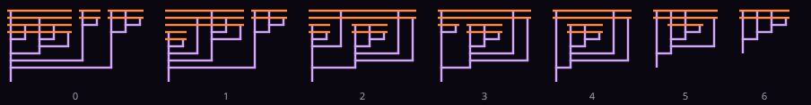

<p align="center"></p>

<p align="center"> </p>

Un interpréteur de **λ-calcul pur** qui dessine les termes en **diagrammes de Tromp**.

<p align="center"><a href="README.md">🇬🇧 English version</a></p>

Le λ-calcul (Church, 1936) est un langage qui n'a *que* des fonctions à un argument : pas de nombres, pas de booléens, pas de `if`, pas de boucles. Et pourtant on peut tout calculer avec. Ici, `FACT 4` donne bien 24, mais 24 est une fonction, `SI` est une fonction, et la récursion vient du combinateur **Y**, une fonction qui n'a même pas besoin de nom.


*Le combinateur Y en diagramme de Tromp : `λf. (λx. f (x x)) (λx. f (x x))`.*



*`PLUS 1 2`, une réduction β par image, jusqu'à `3`.*

## Utilisation

```sh
python3 lambda.py                  # boucle interactive, prélude chargé
python3 lambda.py exemples.lam     # exécuter un fichier
python3 lambda.py -e "FACT 4"      # une expression
python3 tests.py                   # 20 vérifications
```

```
λ> FIB 7
  = 13   λf x. f (f (f (… (f x))))   (6119 réductions β)
λ> λn. PLUS 1 n
  = SUCC   λn f x. f (n f x)   (4 réductions β)
λ> :trace
λ> S K K
     0  [(λx y z. x z (y z)) (λx y. x)] (λx y. x)
     1  [(λy z. (λx y'. x) z (y z)) (λx y. x)]
     2  λz. [(λx y. x) z] ((λx y. x) z)
     3  λz. [(λy. z) ((λx y. x) z)]
  = I   λz. z   (4 réductions β)
λ> :dessin y.svg Y
λ> :film plus.svg PLUS 1 2
```

On écrit `λx y. corps` ou `\x y. corps`, l'application se fait par juxtaposition (`f a b`), les nombres sont des entiers de Church, et `NOM = terme` définit un raccourci. Le [prélude](prelude.lam) fournit booléens, entiers, paires, listes, `Y`, `FACT`, `FIB`...

Quand le résultat est un entier, un booléen ou une définition connue, il est reconnu : `λn. PLUS 1 n` est affiché comme `SUCC`, parce que sa forme normale est exactement celle de `SUCC`.

## Comment ça marche

**Indices de de Bruijn.** En interne, une variable n'a pas de nom mais un numéro : le nombre de λ à remonter pour trouver celui qui la lie. `λx. λy. x` devient `λ λ 1`. Plus aucun risque de capture de variable lors d'une substitution, et deux termes équivalents (au renommage près) sont *égaux*. Les noms ne servent qu'à l'affichage, et sont renommés (`x'`) quand ils prêteraient à confusion.

**Ordre normal.** À chaque étape on réduit le rédex le plus à gauche et le plus à l'extérieur. Cet ordre a une propriété remarquable (théorème de standardisation) : si une forme normale existe, il la trouve. C'est indispensable avec `Y`, qui partirait à l'infini dans un autre ordre.

**Partage.** Chaque sous-terme connaît le plus grand indice libre qu'il contient. Une substitution ou un décalage qui ne peut pas le toucher le renvoie tel quel au lieu de le reconstruire : `exemples.lam` est passé de 26 s à 1 s grâce à ça.

**Normalisation par évaluation (`:rapide`).** Un deuxième moteur, qui ne compte pas les étapes : le terme est traduit en vraies fermetures Python, paresseuses (un argument n'est calculé que s'il sert, et une seule fois), on les exécute, puis on « relit » le résultat en terme en appliquant les fonctions à des variables neutres. `tests.py` vérifie que les deux moteurs trouvent toujours la même forme normale. Un « carburant » arrête les calculs qui ne finissent pas (`OMEGA`).

**Diagrammes de Tromp.** Inventés par John Tromp :
- chaque λ est une barre horizontale (orange) ;
- chaque variable est un trait vertical qui descend de la barre du λ qui la lie ;
- une application relie par un trait horizontal (en bas) le trait de la fonction et celui de l'argument ; celui de la fonction continue vers le bas.

Un entier de Church `n = λf x. f (f (… x))` devient un peigne à n dents :


## Le prélude en une ligne chacun

| | |
|---|---|
| `VRAI = λa b. a`, `FAUX = λa b. b` | un booléen *choisit* entre deux valeurs |
| `3 = λf x. f (f (f x))` | un entier est « appliquer f n fois » |
| `PLUS = λm n f x. m f (n f x)` | f n fois, puis m fois |
| `PRED = λn f x. n (λg h. h (g f)) (λu. x) (λu. u)` | le prédécesseur, étonnamment difficile (Kleene l'aurait trouvé chez le dentiste) |
| `Y = λf. (λx. f (x x)) (λx. f (x x))` | `Y g` se réduit en `g (Y g)` : la récursion |
