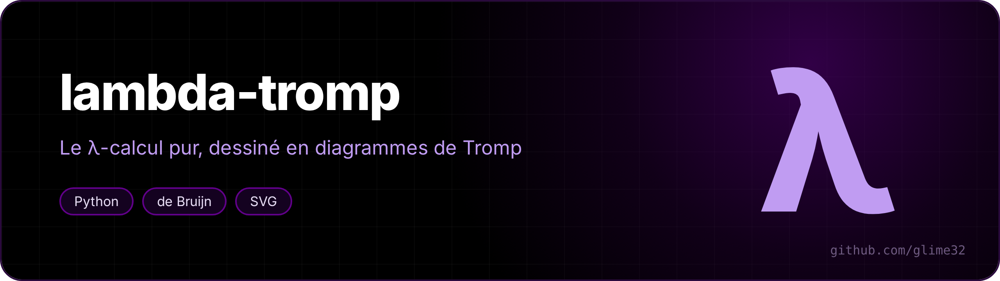
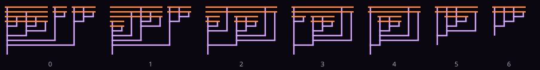
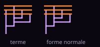

<p align="center"></p>

<p align="center"> </p>

A **pure λ-calculus** interpreter that draws terms as **Tromp diagrams**.

<p align="center"><a href="README.fr.md">🇫🇷 Version française</a></p>

The λ-calculus (Church, 1936) is a language that has *only* one-argument functions: no numbers, no booleans, no `if`, no loops. And yet it can compute anything. Here, `FACT 4` does give 24, but 24 is a function, `SI` (if) is a function, and recursion comes from the **Y** combinator, a function that doesn't even need a name.


*The Y combinator as a Tromp diagram: `λf. (λx. f (x x)) (λx. f (x x))`.*



*`PLUS 1 2`, one β-reduction per frame, down to `3`.*

## Usage

```sh
python3 lambda.py                  # interactive loop, prelude loaded
python3 lambda.py exemples.lam     # run a file
python3 lambda.py -e "FACT 4"      # one expression
python3 tests.py                   # 20 checks
```

The interpreter talks French (`réductions β` = β-reductions, `:dessin` = drawing):

```
λ> FIB 7
  = 13   λf x. f (f (f (… (f x))))   (6119 réductions β)
λ> λn. PLUS 1 n
  = SUCC   λn f x. f (n f x)   (4 réductions β)
λ> :trace
λ> S K K
     0  [(λx y z. x z (y z)) (λx y. x)] (λx y. x)
     1  [(λy z. (λx y'. x) z (y z)) (λx y. x)]
     2  λz. [(λx y. x) z] ((λx y. x) z)
     3  λz. [(λy. z) ((λx y. x) z)]
  = I   λz. z   (4 réductions β)
λ> :dessin y.svg Y
λ> :film plus.svg PLUS 1 2
```

Write `λx y. body` or `\x y. body`, application is juxtaposition (`f a b`), numbers are Church numerals, and `NAME = term` defines a shortcut. The [prelude](prelude.lam) provides booleans, numbers, pairs, lists, `Y`, `FACT`, `FIB`...

When the result is a number, a boolean or a known definition, it is recognised: `λn. PLUS 1 n` is shown as `SUCC`, because its normal form is exactly that of `SUCC`.

## How it works

**De Bruijn indices.** Internally, a variable has no name but a number: how many λs to go up to find the one that binds it. `λx. λy. x` becomes `λ λ 1`. No more risk of variable capture during substitution, and two equivalent terms (up to renaming) are *equal*. Names are only for display, and get renamed (`x'`) when they would be confusing.

**Normal order.** At each step, the leftmost outermost redex is reduced. This order has a remarkable property (the standardisation theorem): if a normal form exists, it finds it. That's essential with `Y`, which would run off to infinity in another order.

**Sharing.** Each subterm knows the largest free index it contains. A substitution or a shift that can't touch it returns it as is instead of rebuilding it: `exemples.lam` went from 26 s to 1 s thanks to that.

**Normalisation by evaluation (`:rapide`).** A second engine, which doesn't count steps: the term is translated into real, lazy Python closures (an argument is only computed if it's used, and only once), they run, then the result is "read back" into a term by applying the functions to neutral variables. `tests.py` checks that both engines always find the same normal form. A "fuel" counter stops computations that never end (`OMEGA`).

**Tromp diagrams.** Invented by John Tromp:
- each λ is a horizontal bar (orange);
- each variable is a vertical line going down from the bar of the λ that binds it;
- an application links the function's line and the argument's line with a horizontal line (at the bottom); the function's line keeps going down.

A Church numeral `n = λf x. f (f (… x))` becomes a comb with n teeth:



## The prelude, one line each

The prelude uses French names: `VRAI` = true, `FAUX` = false.

| | |
|---|---|
| `VRAI = λa b. a`, `FAUX = λa b. b` | a boolean *chooses* between two values |
| `3 = λf x. f (f (f x))` | a number is "apply f n times" |
| `PLUS = λm n f x. m f (n f x)` | f n times, then m times |
| `PRED = λn f x. n (λg h. h (g f)) (λu. x) (λu. u)` | the predecessor, surprisingly hard (Kleene supposedly found it at the dentist's) |
| `Y = λf. (λx. f (x x)) (λx. f (x x))` | `Y g` reduces to `g (Y g)`: recursion |
